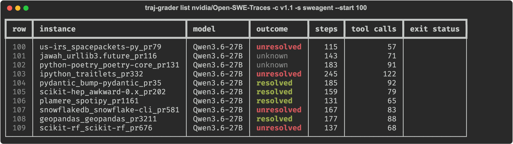
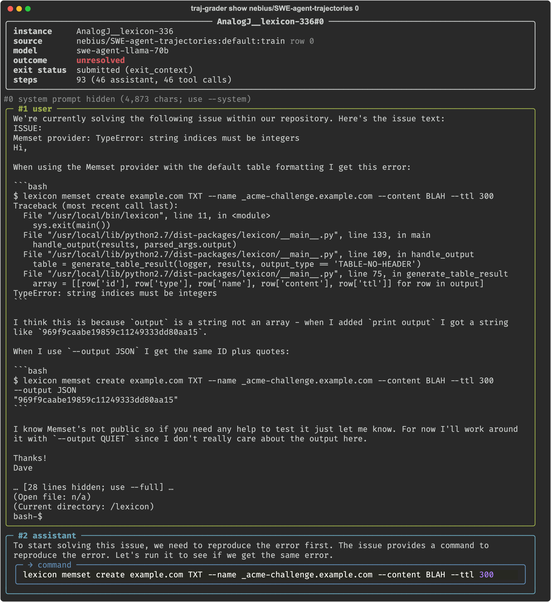
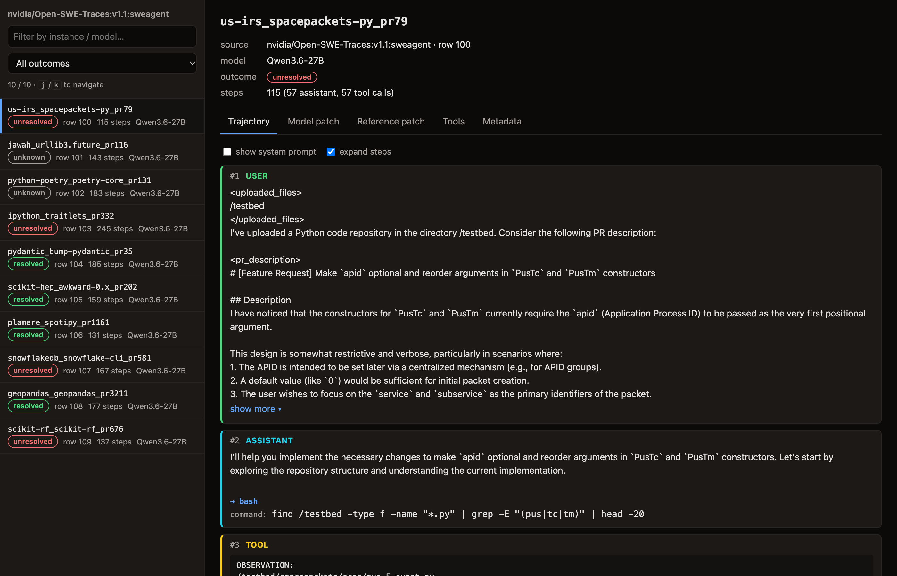

# traj-viewer

View agent trajectories from Hugging Face datasets or local files.

Supported formats (auto-detected from columns, see `src/traj_viewer/adapters.py`):

- **swe-agent** — `trajectory` list, e.g. `nebius/SWE-agent-trajectories`
- **chat-messages** — OpenAI-style `messages` with `tool_calls`, e.g. `nvidia/Open-SWE-Traces`
- **opencode** — local [opencode](https://opencode.ai) sessions, one trajectory per session

## Usage

```bash
# Configs/splits of a Hub dataset
uv run traj-viewer info nvidia/Open-SWE-Traces

# Summary table
uv run traj-viewer list nebius/SWE-agent-trajectories -n 10
uv run traj-viewer list nvidia/Open-SWE-Traces -c v1.1 -s sweagent --start 100

# One trajectory in the terminal (--full, --system, --no-pager, --instance <id>)
uv run traj-viewer show nebius/SWE-agent-trajectories 0

# HTML viewer (written to out/, opened in the browser; j/k to navigate)
uv run traj-viewer html nebius/SWE-agent-trajectories -n 50
uv run traj-viewer show nebius/SWE-agent-trajectories 0 --html
```

Local `.jsonl`, `.json` and `.parquet` files work in place of a dataset id.

Use `opencode` as the dataset id to browse your local opencode sessions (read from
`~/.local/share/opencode/opencode.db`, or pass another `.db` path):

    uv run traj-viewer list opencode -n 10
    uv run traj-viewer show opencode 3

## Screenshots

`list` summarizes a range of trajectories:



`show` prints one trajectory step by step (long messages are truncated unless `--full` is passed):



`html` builds a self-contained viewer with filtering and keyboard navigation:



Hub datasets are read from the Hub's auto-converted parquet branch one row group at a time,
so peeking at a few rows doesn't download the whole dataset.
